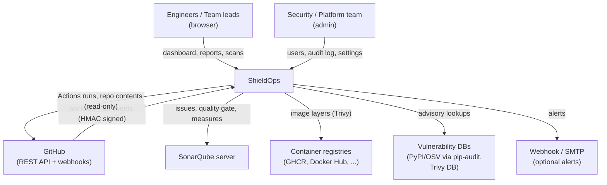
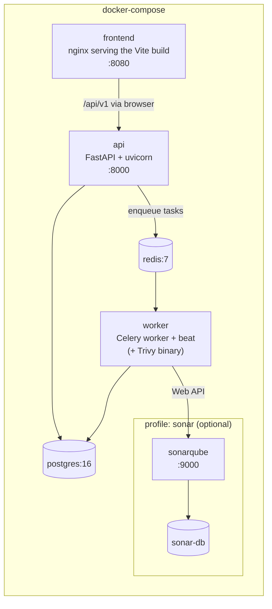
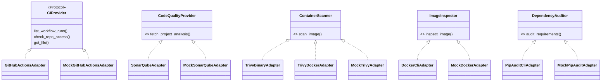
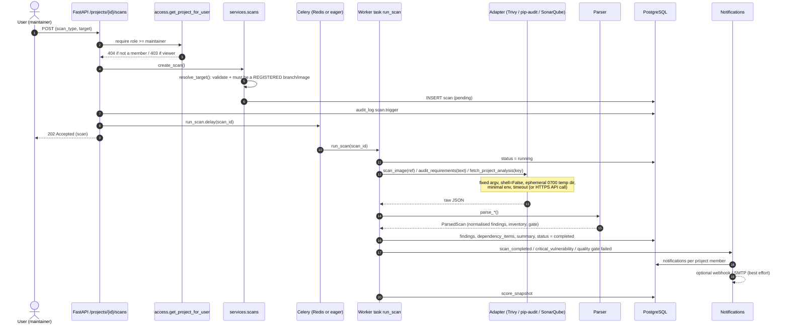
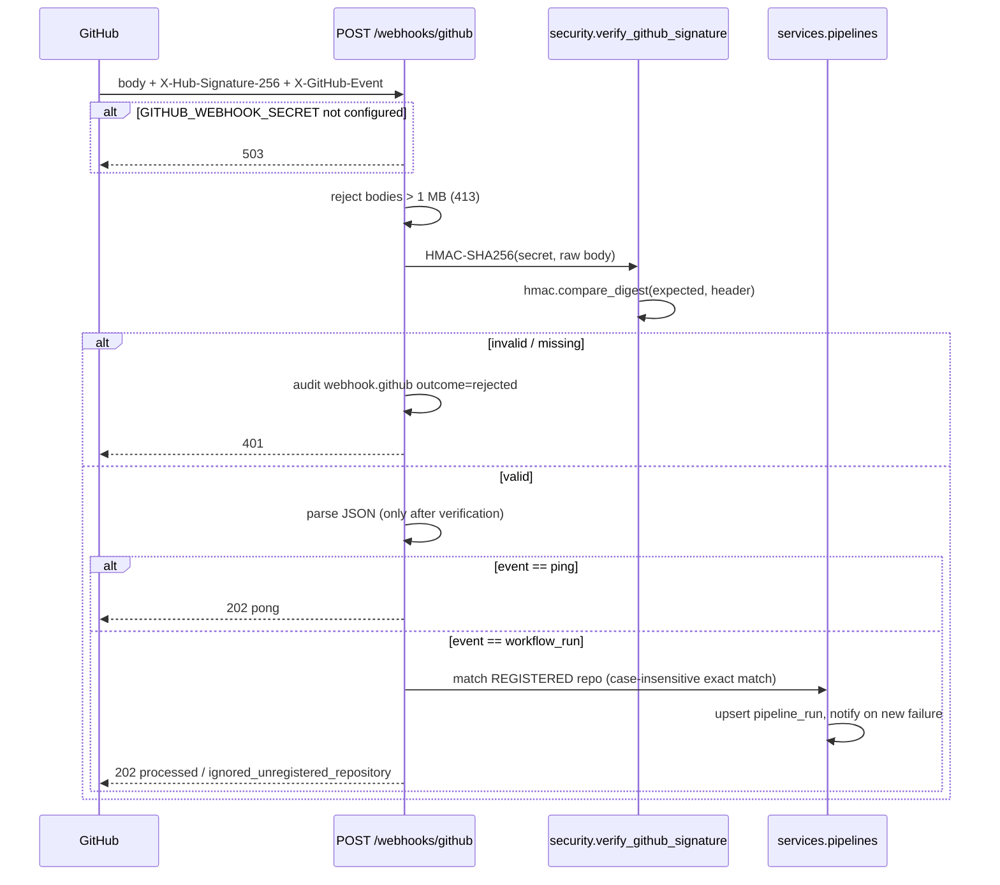
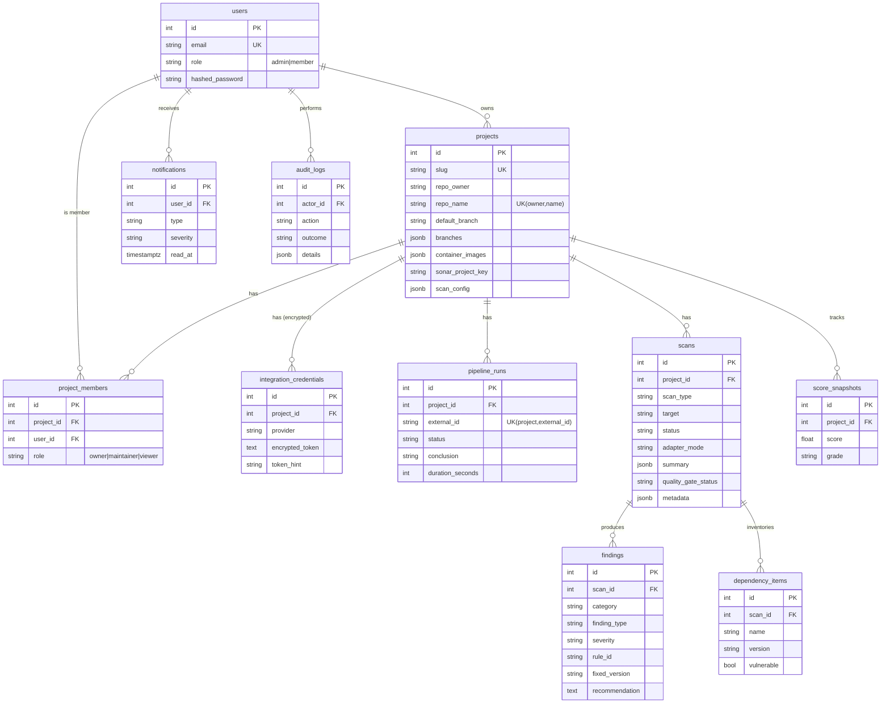

# ShieldOps Architecture

This document describes how ShieldOps (DevSecOps Automation Platform) is structured, how
scans flow through the system, and the security reasoning behind the design.

## 1. System context

## 2. Containers

Locally (no Docker) the API runs with `CELERY_TASK_ALWAYS_EAGER=true`, so tasks execute
in-process and Redis is not required. Tests use the same mode.

## 3. Backend layers

| Layer | Package | Responsibility |
|---|---|---|
| HTTP | `app/api/routes/*` | Routing, request/response schemas, auth dependencies, audit calls, HTTP error mapping |
| Schemas | `app/schemas.py` | Pydantic v2 validation (wraps the strict validators in `app/core/validators.py`) |
| Services | `app/services/*` | Business logic: scan orchestration, pipeline ingestion, scoring, reporting, notifications, access control, credentials, audit |
| Parsers | `app/parsers/*` | Pure functions turning raw tool output into normalised `ParsedFinding` / `ParsedScan` / `ParsedPipelineRun` |
| Adapters | `app/adapters/*` | Talk to the outside world (HTTP APIs, subprocesses). One interface, real + mock implementations |
| Persistence | `app/models.py`, `app/db/*`, `alembic/` | SQLAlchemy 2.0 typed ORM on PostgreSQL; Alembic migrations are the schema source of truth |
| Workers | `app/worker/*` | Celery tasks (`run_scan`, `sync_project_pipelines`, `sync_all_pipelines` on a 15-minute beat) |

Parsers never do I/O and adapters never touch the database. That keeps parsing testable
against fixtures and lets adapters be swapped without touching business logic.

## 4. Integration adapter pattern

`app/adapters/registry.py` selects the implementation from configuration
(`GITHUB_MODE`, `SONARQUBE_MODE`, `TRIVY_MODE`, `DOCKER_MODE`, `PIP_AUDIT_MODE`); **mock is the
default for all of them**. Tests can inject any adapter with `registry.override(name, adapter)`.
Mock adapters return data in **exactly the same raw format** as the real tools, so the same
parsers and services run in both modes. Mock output is deterministic per input (seeded by a
SHA-256 of the repo/image/key), which keeps demos and tests stable.

## 5. Scan execution

On `AdapterError`/`ParseError` the scan is marked `failed` with a non-sensitive error message
and a `scan_failed` notification is sent.

Reports produced elsewhere (for example Trivy or pip-audit in GitHub Actions) can be ingested
through `POST /projects/{id}/scans/import`, which reuses the same target validation, parser,
persistence and notification path.

## 6. Webhook signature verification

The signature is computed over the **raw request bytes** before any JSON parsing.

## 7. Data model

The full DDL is in [database_schema.sql](database_schema.sql) (generated from the Alembic migration).

## 8. RBAC

| Capability | Viewer | Maintainer | Owner | Platform admin |
|---|:-:|:-:|:-:|:-:|
| See project, scans, findings, pipelines, reports | yes | yes | yes | yes (all projects) |
| Edit project config, trigger scans, import reports, sync pipelines | | yes | yes | yes |
| Manage members, set/delete GitHub token, delete project | | | yes | yes |
| List users, change roles, read audit log | | | | yes |

- The project creator is its owner. The first registered user becomes platform admin.
- Users who are not members of a project get **404** rather than 403, so project existence is not revealed.
- Notifications go to the project owner and all members.

## 9. Audit logging

`services/audit.record()` writes an `audit_logs` row (actor, action, resource, outcome, client IP,
scrubbed details) and emits a structured log line. Keys that look sensitive (`password`, `token`,
`secret`, `authorization`, `api_key`) are redacted before storage. Audited actions:
`auth.login` (success/failure/blocked), `user.register`, `user.update`, `project.create|update|delete`,
`project.member.upsert|remove`, `credential.set|delete`, `scan.trigger` (including denied attempts),
`scan.import`, `pipeline.sync`, `report.export`, `webhook.github` (including rejected signatures).

## 10. Threat model summary

| Threat | Mitigation |
|---|---|
| Command injection via image refs / branches / paths | Strict regex validation; fixed argv lists; `shell=False`; `--` before positional args; no string interpolation into commands |
| Malicious `requirements.txt` (pip options, index URLs, VCS/URL installs) | Sanitiser keeps only pinned `name==version[; marker]` lines; pip-audit runs with `--no-deps --disable-pip` (no install/build) |
| Scanner escaping or polluting the host | Ephemeral `0700` temp dir per run, minimal env (no secrets), timeouts; Trivy container mode adds `--rm --read-only --cap-drop ALL no-new-privileges` |
| Scanning third-party assets without authorization | Project must be registered; caller must be maintainer/owner; target must be one of the project's registered branches/images; GitHub token is verified against the repo before storage |
| Forged webhooks | HMAC-SHA256 over the raw body, constant-time comparison, required secret, size limit, unregistered repos ignored |
| Token theft | Fernet encryption at rest, never returned or logged, log redaction filter, least-privilege fine-grained PAT |
| SSRF via configurable URLs | Outbound hosts come from server configuration only (not user input); GitHub API paths are built from validated owner/repo |
| Brute force | Login throttle per email+IP, bcrypt cost 12 |
| CSV/HTML injection in reports | CSV cells starting with `= + - @` are prefixed; HTML report escapes every value |
| Untrusted artifact deployment | Platform never deploys; Docker adapter is read-only (`image inspect`) |

## 11. Frontend architecture

- **Vite + React + TypeScript**, styled with **Tailwind CSS**; charts with **Recharts**.
- **TanStack React Query** handles server state (caching, refetching, mutations with
  invalidation); a small typed `api` client wraps `fetch`, attaches the JWT and maps 401 to logout.
- **React Router** with a `ProtectedRoute` guard and an `AuthProvider` context (JWT in
  `sessionStorage`, cleared on logout or 401).
- Pages: Login, Overview, Projects, Project detail, Pipelines, Code quality, Vulnerabilities,
  Container scans, Dependency scans, Reports, Notifications, Settings.
- The production build is served by nginx (non-root) with security headers.

## 12. Design decisions and trade-offs

| Decision | Why | Trade-off |
|---|---|---|
| Sync SQLAlchemy + psycopg2 | Same code path in API (threadpool) and Celery workers; simple and robust | Fewer concurrent requests per process than a fully async stack |
| Celery with eager mode | Real queue in Docker; zero-infrastructure local dev and deterministic tests | Eager mode runs scans inside the request (fine for mocks, slow for real scanners) |
| Mock adapters by default | Anyone can run and evaluate the platform without credentials | Mock data is illustrative, not a live advisory feed |
| Pull SonarQube results (don't run the scanner) | SonarQube analysis belongs in CI next to the code; the platform aggregates | Requires a reachable SonarQube server for real mode |
| Report import endpoint | Lets CI run Trivy/pip-audit close to the build and push results | Currently uses a user JWT (CI ingest tokens are on the roadmap) |
| pip-audit severity heuristic | pip-audit output has no severity | `medium` (fix available) / `high` (no fix) until OSV enrichment lands |
| PostgreSQL only (JSONB, window functions) | Rich querying for "latest scan per target" and flexible metadata | No SQLite quick-start; tests need Postgres (embedded `pgserver` locally) |
| Latest scan per (type, target) drives metrics | Re-scans replace old results instead of double counting | Historical findings remain queryable by `scan_id` but are not "open" |
